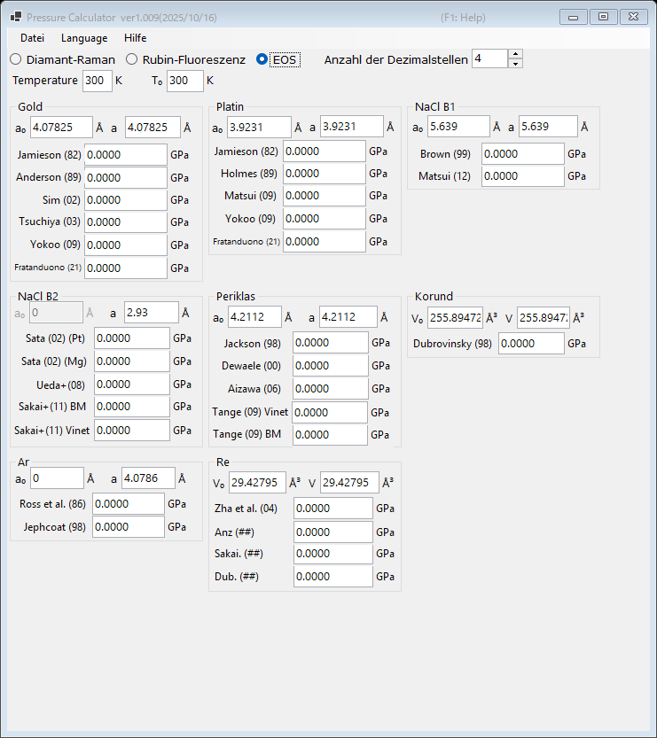

# 3. Zustandsgleichung (EOS)

Der Druck wird aus der gemessenen Gitterkonstante (oder dem Elementarzellenvolumen) eines Standardmaterials anhand publizierter Zustandsgleichungen bestimmt. Dies ist die Standardmethode in Röntgenbeugungsexperimenten unter hohem Druck. Wählen Sie oben im Hauptfenster **EOS**.

{width=700px}

## Arbeitsablauf

1. Geben Sie die Messtemperatur **Temperature** und die Referenztemperatur **T₀** ein (in K). Thermische Zustandsgleichungen verwenden diese Werte; Raumtemperatur-Skalen ignorieren die Differenz.
2. Geben Sie für jedes Standardmaterial die Gitterkonstante bei Umgebungsbedingungen **a₀** (Å) und die gemessene Gitterkonstante **a** (Å) ein. Für Korund und Rhenium werden stattdessen die Elementarzellenvolumina **V₀** und **V** (ų) eingegeben.
3. Der mit jeder publizierten Skala berechnete Druck wird sofort angezeigt (in GPa).

## Verfügbare Standards und Skalen

| Material | Skalen |
|---|---|
| Gold | Jamieson (1982), Anderson (1989), Shim (2002), Tsuchiya (2003), Yokoo (2009), Fratanduono (2021) |
| Platin | Jamieson (1982), Holmes (1989), Matsui (2009), Yokoo (2009), Fratanduono (2021) |
| NaCl B1 | Brown (1999), Matsui (2012) |
| NaCl B2 | Sata (2002) (Pt/Mg-Druckreferenzen), Ueda+ (2008), Sakai+ (2011) BM/Vinet |
| Periklas (MgO) | Jackson (1998), Dewaele (2000), Aizawa (2006), Tange (2009) Vinet/BM |
| Korund (Al₂O₃) | Dubrovinsky (1998) |
| Ar | Ross et al. (1986), Jephcoat (1998) |
| Re | Zha et al. (2004) und andere |
| Mo | Zhao+ (2000), Huang+ (2016) MGD |
| Pb | Strässle+ (2014) |

!!! note
    Verschiedene Skalen für dasselbe Material können um mehrere Prozent voneinander abweichen, insbesondere bei Drücken im Multimegabar-Bereich. Geben Sie bei der Veröffentlichung von Ergebnissen an, welche Skala verwendet wurde.

## Gültiger Temperaturbereich

Jede Skala ist nur in einem bestimmten Temperaturbereich gültig. Liegt **Temperature** (bei Pb auch **T₀**) außerhalb des Bereichs einer Skala, wird deren Druck rot angezeigt, rechts von **T₀** erscheint der Hinweis „⚠ Rot: …“, und der Tooltip des Werts nennt den gültigen Bereich. Der Druck selbst wird weiterhin (extrapoliert) berechnet und nicht verändert.

| Material | Skala | Gültiger Bereich | Grundlage |
|---|---|---|---|
| Gold | Jamieson (1982) | 200–1500 K | Bereich der veröffentlichten Tabelle (außerhalb extrapoliert) |
| Gold | Anderson (1989) | ≥ 300 K | thermischer Druck linear in (T − 300 K); unterhalb der Raumtemperatur nicht physikalisch |
| Gold | Shim (2002) | — | thermischer Druck nach Mie–Grüneisen–Debye; kein Bereich festgelegt (keine Warnung) |
| Gold | Tsuchiya (2003) | 300–2500 K | Bereich der veröffentlichten Tabelle (außerhalb extrapoliert) |
| Gold | Yokoo (2009) | 0–3000 K | Bereich der veröffentlichten Tabelle (außerhalb extrapoliert) |
| Gold | Fratanduono (2021) | 290–310 K | Raumtemperatur-Isotherme (300 K); die Temperatur wird nicht verwendet |
| Platin | Jamieson (1982) | 200–1500 K | Bereich der veröffentlichten Tabelle (außerhalb extrapoliert) |
| Platin | Holmes (1989) | ≥ 300 K | thermischer Druck linear in (T − 300 K); unterhalb der Raumtemperatur nicht physikalisch |
| Platin | Matsui (2009) | ≤ 3000 K | von den Autoren angegeben (bis 3000 K und 300 GPa) |
| Platin | Yokoo (2009) | 0–3000 K | Bereich der veröffentlichten Tabelle (außerhalb extrapoliert) |
| Platin | Fratanduono (2021) | 290–310 K | Raumtemperatur-Isotherme (300 K); die Temperatur wird nicht verwendet |
| NaCl B1 | Brown (1999) | 300–1200 K | Bereich der veröffentlichten Tabelle (außerhalb extrapoliert) |
| NaCl B1 | Matsui (2012) | — | thermischer Druck nach Mie–Grüneisen–Debye; kein Bereich festgelegt (keine Warnung) |
| NaCl B2 | Sata (2002) (Pt), (Mg) | 290–310 K | Raumtemperatur-Isotherme (300 K); die Temperatur wird nicht verwendet |
| NaCl B2 | Ueda+ (2008) | ≥ 300 K | thermischer Druck linear in (T − 300 K); unterhalb der Raumtemperatur nicht physikalisch |
| NaCl B2 | Sakai+ (2011) BM, Vinet | 290–310 K | Raumtemperatur-Isotherme (300 K); die Temperatur wird nicht verwendet |
| Periklas (MgO) | Jackson (1998), Dewaele (2000), Aizawa (2006), Tange (2009) Vinet/BM | — | thermischer Druck nach Mie–Grüneisen–Debye; kein Bereich festgelegt (keine Warnung) |
| Korund (Al₂O₃) | Dubrovinsky (1998) | ≥ 300 K | Hochtemperatur-Anpassung von Wärmeausdehnung und K(T); unterhalb der Raumtemperatur nicht physikalisch |
| Ar | Ross et al. (1986) | 290–310 K | Raumtemperatur-Isotherme (300 K); die Temperatur wird nicht verwendet |
| Ar | Jephcoat (1998) | — | thermischer Druck nach Mie–Grüneisen–Debye; kein Bereich festgelegt (keine Warnung) |
| Re | Zha et al. (2004) | 300–3000 K | Bereich der veröffentlichten Tabelle (außerhalb extrapoliert) |
| Re | Anz (##), Sakai. (##), Dub. (##) | 290–310 K | Raumtemperatur-Isotherme (300 K); die Temperatur wird nicht verwendet |
| Mo | Zhao+ (2000) | ≥ 300 K | Hochtemperatur-Anpassung von Wärmeausdehnung und K(T); unterhalb der Raumtemperatur nicht physikalisch |
| Mo | Huang+ (2016) MGD | — | thermischer Druck nach Mie–Grüneisen–Debye; kein Bereich festgelegt (keine Warnung) |
| Pb | Strässle+ (2014) | T: 0–300 K, T₀: 0–310 K | Bereich der veröffentlichten Tabelle (außerhalb extrapoliert) |

Bei den 300-K-Isothermen erscheint zwischen 290 und 310 K keine Warnung, damit eine Raumtemperatur-Eingabe wie 295 K sie nicht auslöst. Die im Fenster mit „Anz“, „Sakai.“ und „Dub.“ bezeichneten Re-Skalen sind ebenfalls 300-K-Isothermen.
