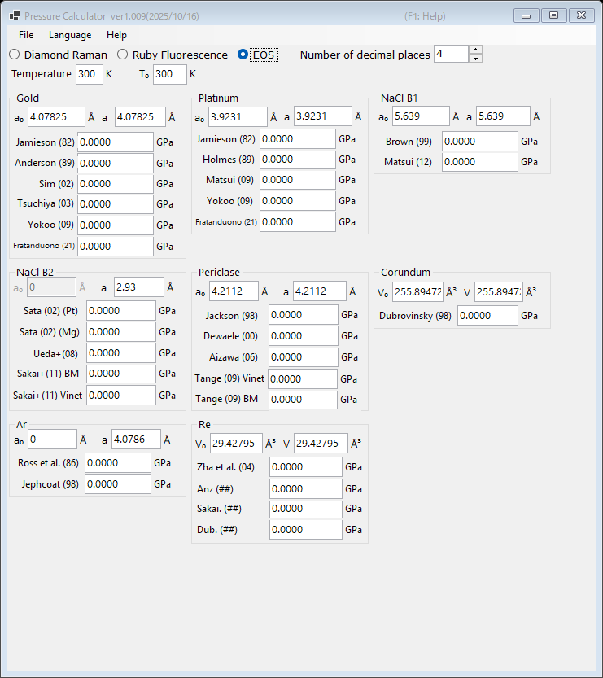

# 3. Equation of states (EOS)

Pressure is determined from the measured lattice constant (or unit-cell volume) of a standard material, using published equations of state. This is the standard method in X-ray diffraction experiments under high pressure. Select **EOS** at the top of the main window.

{width=700px}

## Workflow

1. Enter the measurement temperature **Temperature** and the reference temperature **T₀** (in K). Thermal equations of state use them; room-temperature scales ignore the difference.
2. For each standard material, enter the ambient lattice constant **a₀** (Å) and the measured lattice constant **a** (Å). For corundum and rhenium, the unit-cell volumes **V₀** and **V** (ų) are entered instead.
3. The pressure calculated with each published scale is displayed immediately (in GPa).

## Available standards and scales

| Material | Scales |
|---|---|
| Gold | Jamieson (1982), Anderson (1989), Shim (2002), Tsuchiya (2003), Yokoo (2009), Fratanduono (2021) |
| Platinum | Jamieson (1982), Holmes (1989), Matsui (2009), Yokoo (2009), Fratanduono (2021) |
| NaCl B1 | Brown (1999), Matsui (2012) |
| NaCl B2 | Sata (2002) (Pt/Mg pressure references), Ueda+ (2008), Sakai+ (2011) BM/Vinet |
| Periclase (MgO) | Jackson (1998), Dewaele (2000), Aizawa (2006), Tange (2009) Vinet/BM |
| Corundum (Al₂O₃) | Dubrovinsky (1998) |
| Ar | Ross et al. (1986), Jephcoat (1998) |
| Re | Zha et al. (2004) and others |
| Mo | Zhao+ (2000), Huang+ (2016) MGD |
| Pb | Strässle+ (2014) |

!!! note
    Different scales for the same material can disagree by several percent, particularly at multimegabar pressures. Report which scale was used when publishing results.

## Temperature validity range

Each scale is valid only within a certain temperature range. When **Temperature** (for Pb, also **T₀**) is outside the range of a scale, its pressure is shown in red, the message "⚠ Red: …" appears to the right of **T₀**, and the tooltip of the value gives the valid range. The pressure itself is still calculated (extrapolated) and is not changed.

| Material | Scale | Valid range | Basis |
|---|---|---|---|
| Gold | Jamieson (1982) | 200–1500 K | range of the published table (extrapolated outside it) |
| Gold | Anderson (1989) | ≥ 300 K | thermal pressure linear in (T − 300 K); not physical below room temperature |
| Gold | Shim (2002) | — | Mie–Grüneisen–Debye thermal pressure; no range set (no warning) |
| Gold | Tsuchiya (2003) | 300–2500 K | range of the published table (extrapolated outside it) |
| Gold | Yokoo (2009) | 0–3000 K | range of the published table (extrapolated outside it) |
| Gold | Fratanduono (2021) | 290–310 K | room-temperature (300 K) isotherm; the temperature is not used |
| Platinum | Jamieson (1982) | 200–1500 K | range of the published table (extrapolated outside it) |
| Platinum | Holmes (1989) | ≥ 300 K | thermal pressure linear in (T − 300 K); not physical below room temperature |
| Platinum | Matsui (2009) | ≤ 3000 K | stated by the authors (up to 3000 K and 300 GPa) |
| Platinum | Yokoo (2009) | 0–3000 K | range of the published table (extrapolated outside it) |
| Platinum | Fratanduono (2021) | 290–310 K | room-temperature (300 K) isotherm; the temperature is not used |
| NaCl B1 | Brown (1999) | 300–1200 K | range of the published table (extrapolated outside it) |
| NaCl B1 | Matsui (2012) | — | Mie–Grüneisen–Debye thermal pressure; no range set (no warning) |
| NaCl B2 | Sata (2002) (Pt), (Mg) | 290–310 K | room-temperature (300 K) isotherm; the temperature is not used |
| NaCl B2 | Ueda+ (2008) | ≥ 300 K | thermal pressure linear in (T − 300 K); not physical below room temperature |
| NaCl B2 | Sakai+ (2011) BM, Vinet | 290–310 K | room-temperature (300 K) isotherm; the temperature is not used |
| Periclase (MgO) | Jackson (1998), Dewaele (2000), Aizawa (2006), Tange (2009) Vinet/BM | — | Mie–Grüneisen–Debye thermal pressure; no range set (no warning) |
| Corundum (Al₂O₃) | Dubrovinsky (1998) | ≥ 300 K | high-temperature fit of thermal expansion and K(T); not physical below room temperature |
| Ar | Ross et al. (1986) | 290–310 K | room-temperature (300 K) isotherm; the temperature is not used |
| Ar | Jephcoat (1998) | — | Mie–Grüneisen–Debye thermal pressure; no range set (no warning) |
| Re | Zha et al. (2004) | 300–3000 K | range of the published table (extrapolated outside it) |
| Re | Anz (##), Sakai. (##), Dub. (##) | 290–310 K | room-temperature (300 K) isotherm; the temperature is not used |
| Mo | Zhao+ (2000) | ≥ 300 K | high-temperature fit of thermal expansion and K(T); not physical below room temperature |
| Mo | Huang+ (2016) MGD | — | Mie–Grüneisen–Debye thermal pressure; no range set (no warning) |
| Pb | Strässle+ (2014) | T: 0–300 K, T₀: 0–310 K | range of the published table (extrapolated outside it) |

For the 300 K isotherms the warning is not shown between 290 and 310 K, so that a room-temperature input such as 295 K does not trigger it. The Re scales labelled "Anz", "Sakai." and "Dub." in the window are 300 K isotherms as well.
