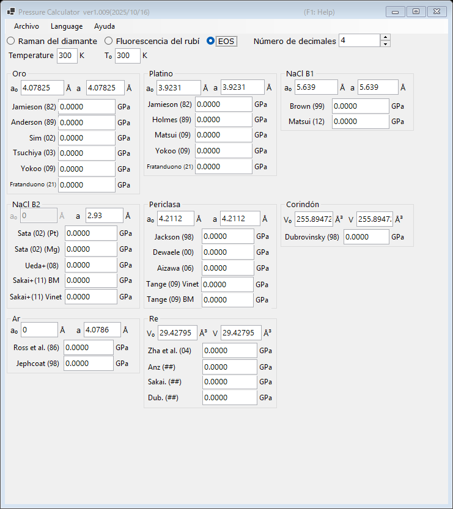

# 3. Ecuación de estado (EOS)

La presión se determina a partir de la constante de red (o del volumen de la celda unidad) medida de un material estándar, utilizando ecuaciones de estado publicadas. Es el método estándar en los experimentos de difracción de rayos X a alta presión. Seleccione **EOS** en la parte superior de la ventana principal.

{width=700px}

## Flujo de trabajo

1. Introduzca la temperatura de medición **Temperature** y la temperatura de referencia **T₀** (en K). Las ecuaciones de estado térmicas las utilizan; las escalas a temperatura ambiente ignoran la diferencia.
2. Para cada material estándar, introduzca la constante de red en condiciones ambientales **a₀** (Å) y la constante de red medida **a** (Å). Para el corindón y el renio se introducen en su lugar los volúmenes de la celda unidad **V₀** y **V** (ų).
3. La presión calculada con cada escala publicada se muestra de inmediato (en GPa).

## Estándares y escalas disponibles

| Material | Escalas |
|---|---|
| Oro | Jamieson (1982), Anderson (1989), Shim (2002), Tsuchiya (2003), Yokoo (2009), Fratanduono (2021) |
| Platino | Jamieson (1982), Holmes (1989), Matsui (2009), Yokoo (2009), Fratanduono (2021) |
| NaCl B1 | Brown (1999), Matsui (2012) |
| NaCl B2 | Sata (2002) (referencias de presión Pt/Mg), Ueda+ (2008), Sakai+ (2011) BM/Vinet |
| Periclasa (MgO) | Jackson (1998), Dewaele (2000), Aizawa (2006), Tange (2009) Vinet/BM |
| Corindón (Al₂O₃) | Dubrovinsky (1998) |
| Ar | Ross et al. (1986), Jephcoat (1998) |
| Re | Zha et al. (2004) y otros |
| Mo | Zhao+ (2000), Huang+ (2016) MGD |
| Pb | Strässle+ (2014) |

!!! note
    Distintas escalas para un mismo material pueden discrepar en varios por ciento, especialmente a presiones multimegabar. Al publicar los resultados, indique qué escala se ha utilizado.

## Rango de temperatura de validez

Cada escala solo es válida en un cierto rango de temperatura. Cuando **Temperature** (para Pb, también **T₀**) está fuera del rango de una escala, su presión se muestra en rojo, aparece el mensaje «⚠ En rojo: …» a la derecha de **T₀** y la información sobre herramientas del valor indica el rango válido. La presión se sigue calculando (extrapolada) y no se modifica.

| Material | Escala | Rango válido | Fundamento |
|---|---|---|---|
| Oro | Jamieson (1982) | 200–1500 K | rango de la tabla publicada (extrapolada fuera de él) |
| Oro | Anderson (1989) | ≥ 300 K | presión térmica lineal en (T − 300 K); no es física por debajo de la temperatura ambiente |
| Oro | Shim (2002) | — | presión térmica de Mie–Grüneisen–Debye; sin rango fijado (sin aviso) |
| Oro | Tsuchiya (2003) | 300–2500 K | rango de la tabla publicada (extrapolada fuera de él) |
| Oro | Yokoo (2009) | 0–3000 K | rango de la tabla publicada (extrapolada fuera de él) |
| Oro | Fratanduono (2021) | 290–310 K | isoterma a temperatura ambiente (300 K); no se usa la temperatura |
| Platino | Jamieson (1982) | 200–1500 K | rango de la tabla publicada (extrapolada fuera de él) |
| Platino | Holmes (1989) | ≥ 300 K | presión térmica lineal en (T − 300 K); no es física por debajo de la temperatura ambiente |
| Platino | Matsui (2009) | ≤ 3000 K | indicado por los autores (hasta 3000 K y 300 GPa) |
| Platino | Yokoo (2009) | 0–3000 K | rango de la tabla publicada (extrapolada fuera de él) |
| Platino | Fratanduono (2021) | 290–310 K | isoterma a temperatura ambiente (300 K); no se usa la temperatura |
| NaCl B1 | Brown (1999) | 300–1200 K | rango de la tabla publicada (extrapolada fuera de él) |
| NaCl B1 | Matsui (2012) | — | presión térmica de Mie–Grüneisen–Debye; sin rango fijado (sin aviso) |
| NaCl B2 | Sata (2002) (Pt), (Mg) | 290–310 K | isoterma a temperatura ambiente (300 K); no se usa la temperatura |
| NaCl B2 | Ueda+ (2008) | ≥ 300 K | presión térmica lineal en (T − 300 K); no es física por debajo de la temperatura ambiente |
| NaCl B2 | Sakai+ (2011) BM, Vinet | 290–310 K | isoterma a temperatura ambiente (300 K); no se usa la temperatura |
| Periclasa (MgO) | Jackson (1998), Dewaele (2000), Aizawa (2006), Tange (2009) Vinet/BM | — | presión térmica de Mie–Grüneisen–Debye; sin rango fijado (sin aviso) |
| Corindón (Al₂O₃) | Dubrovinsky (1998) | ≥ 300 K | ajuste a alta temperatura de la dilatación térmica y de K(T); no es físico por debajo de la temperatura ambiente |
| Ar | Ross et al. (1986) | 290–310 K | isoterma a temperatura ambiente (300 K); no se usa la temperatura |
| Ar | Jephcoat (1998) | — | presión térmica de Mie–Grüneisen–Debye; sin rango fijado (sin aviso) |
| Re | Zha et al. (2004) | 300–3000 K | rango de la tabla publicada (extrapolada fuera de él) |
| Re | Anz (##), Sakai. (##), Dub. (##) | 290–310 K | isoterma a temperatura ambiente (300 K); no se usa la temperatura |
| Mo | Zhao+ (2000) | ≥ 300 K | ajuste a alta temperatura de la dilatación térmica y de K(T); no es físico por debajo de la temperatura ambiente |
| Mo | Huang+ (2016) MGD | — | presión térmica de Mie–Grüneisen–Debye; sin rango fijado (sin aviso) |
| Pb | Strässle+ (2014) | T: 0–300 K, T₀: 0–310 K | rango de la tabla publicada (extrapolada fuera de él) |

En las isotermas de 300 K el aviso no aparece entre 290 y 310 K, para que una entrada a temperatura ambiente como 295 K no lo active. Las escalas de Re rotuladas «Anz», «Sakai.» y «Dub.» en la ventana también son isotermas de 300 K.
