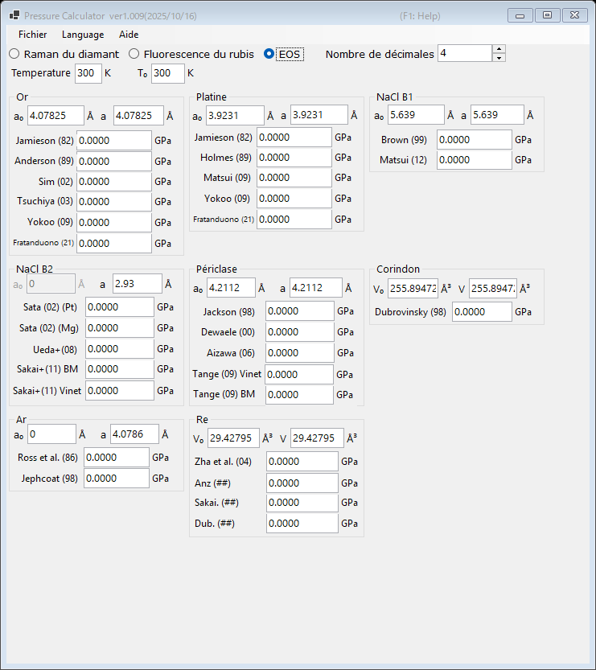

# 3. Équation d'état (EOS)

La pression est déterminée à partir du paramètre de maille (ou du volume de la maille) mesuré d'un matériau étalon, au moyen d'équations d'état publiées. C'est la méthode standard des expériences de diffraction des rayons X sous haute pression. Sélectionnez **EOS** en haut de la fenêtre principale.

{width=700px}

## Procédure

1. Saisissez la température de mesure **Temperature** et la température de référence **T₀** (en K). Les équations d'état thermiques les utilisent ; les échelles à température ambiante ignorent la différence.
2. Pour chaque matériau étalon, saisissez le paramètre de maille aux conditions ambiantes **a₀** (Å) et le paramètre de maille mesuré **a** (Å). Pour le corindon et le rhénium, ce sont les volumes de maille **V₀** et **V** (ų) qui sont saisis à la place.
3. La pression calculée avec chaque échelle publiée s'affiche immédiatement (en GPa).

## Matériaux étalons et échelles disponibles

| Matériau | Échelles |
|---|---|
| Or | Jamieson (1982), Anderson (1989), Shim (2002), Tsuchiya (2003), Yokoo (2009), Fratanduono (2021) |
| Platine | Jamieson (1982), Holmes (1989), Matsui (2009), Yokoo (2009), Fratanduono (2021) |
| NaCl B1 | Brown (1999), Matsui (2012) |
| NaCl B2 | Sata (2002) (références de pression Pt/Mg), Ueda+ (2008), Sakai+ (2011) BM/Vinet |
| Périclase (MgO) | Jackson (1998), Dewaele (2000), Aizawa (2006), Tange (2009) Vinet/BM |
| Corindon (Al₂O₃) | Dubrovinsky (1998) |
| Ar | Ross et al. (1986), Jephcoat (1998) |
| Re | Zha et al. (2004) et autres |
| Mo | Zhao+ (2000), Huang+ (2016) MGD |
| Pb | Strässle+ (2014) |

!!! note
    Des échelles différentes pour un même matériau peuvent diverger de plusieurs pour cent, en particulier aux pressions multimégabar. Indiquez l'échelle utilisée lors de la publication de vos résultats.

## Domaine de température de validité

Chaque échelle n'est valable que dans un certain domaine de température. Lorsque **Temperature** (pour Pb, aussi **T₀**) est hors du domaine d'une échelle, sa pression est affichée en rouge, le message « ⚠ En rouge : … » apparaît à droite de **T₀**, et l'infobulle de la valeur indique le domaine valide. La pression elle-même est toujours calculée (extrapolée) et n'est pas modifiée.

| Matériau | Échelle | Domaine valide | Fondement |
|---|---|---|---|
| Or | Jamieson (1982) | 200–1500 K | domaine de la table publiée (extrapolée en dehors) |
| Or | Anderson (1989) | ≥ 300 K | pression thermique linéaire en (T − 300 K) ; non physique en dessous de la température ambiante |
| Or | Shim (2002) | — | pression thermique de Mie–Grüneisen–Debye ; aucun domaine fixé (pas d'avertissement) |
| Or | Tsuchiya (2003) | 300–2500 K | domaine de la table publiée (extrapolée en dehors) |
| Or | Yokoo (2009) | 0–3000 K | domaine de la table publiée (extrapolée en dehors) |
| Or | Fratanduono (2021) | 290–310 K | isotherme à température ambiante (300 K) ; la température n'est pas utilisée |
| Platine | Jamieson (1982) | 200–1500 K | domaine de la table publiée (extrapolée en dehors) |
| Platine | Holmes (1989) | ≥ 300 K | pression thermique linéaire en (T − 300 K) ; non physique en dessous de la température ambiante |
| Platine | Matsui (2009) | ≤ 3000 K | indiqué par les auteurs (jusqu'à 3000 K et 300 GPa) |
| Platine | Yokoo (2009) | 0–3000 K | domaine de la table publiée (extrapolée en dehors) |
| Platine | Fratanduono (2021) | 290–310 K | isotherme à température ambiante (300 K) ; la température n'est pas utilisée |
| NaCl B1 | Brown (1999) | 300–1200 K | domaine de la table publiée (extrapolée en dehors) |
| NaCl B1 | Matsui (2012) | — | pression thermique de Mie–Grüneisen–Debye ; aucun domaine fixé (pas d'avertissement) |
| NaCl B2 | Sata (2002) (Pt), (Mg) | 290–310 K | isotherme à température ambiante (300 K) ; la température n'est pas utilisée |
| NaCl B2 | Ueda+ (2008) | ≥ 300 K | pression thermique linéaire en (T − 300 K) ; non physique en dessous de la température ambiante |
| NaCl B2 | Sakai+ (2011) BM, Vinet | 290–310 K | isotherme à température ambiante (300 K) ; la température n'est pas utilisée |
| Périclase (MgO) | Jackson (1998), Dewaele (2000), Aizawa (2006), Tange (2009) Vinet/BM | — | pression thermique de Mie–Grüneisen–Debye ; aucun domaine fixé (pas d'avertissement) |
| Corindon (Al₂O₃) | Dubrovinsky (1998) | ≥ 300 K | ajustement à haute température de la dilatation thermique et de K(T) ; non physique en dessous de la température ambiante |
| Ar | Ross et al. (1986) | 290–310 K | isotherme à température ambiante (300 K) ; la température n'est pas utilisée |
| Ar | Jephcoat (1998) | — | pression thermique de Mie–Grüneisen–Debye ; aucun domaine fixé (pas d'avertissement) |
| Re | Zha et al. (2004) | 300–3000 K | domaine de la table publiée (extrapolée en dehors) |
| Re | Anz (##), Sakai. (##), Dub. (##) | 290–310 K | isotherme à température ambiante (300 K) ; la température n'est pas utilisée |
| Mo | Zhao+ (2000) | ≥ 300 K | ajustement à haute température de la dilatation thermique et de K(T) ; non physique en dessous de la température ambiante |
| Mo | Huang+ (2016) MGD | — | pression thermique de Mie–Grüneisen–Debye ; aucun domaine fixé (pas d'avertissement) |
| Pb | Strässle+ (2014) | T: 0–300 K, T₀: 0–310 K | domaine de la table publiée (extrapolée en dehors) |

Pour les isothermes à 300 K, l'avertissement n'apparaît pas entre 290 et 310 K, afin qu'une saisie à température ambiante telle que 295 K ne le déclenche pas. Les échelles du Re nommées « Anz », « Sakai. » et « Dub. » dans la fenêtre sont aussi des isothermes à 300 K.
