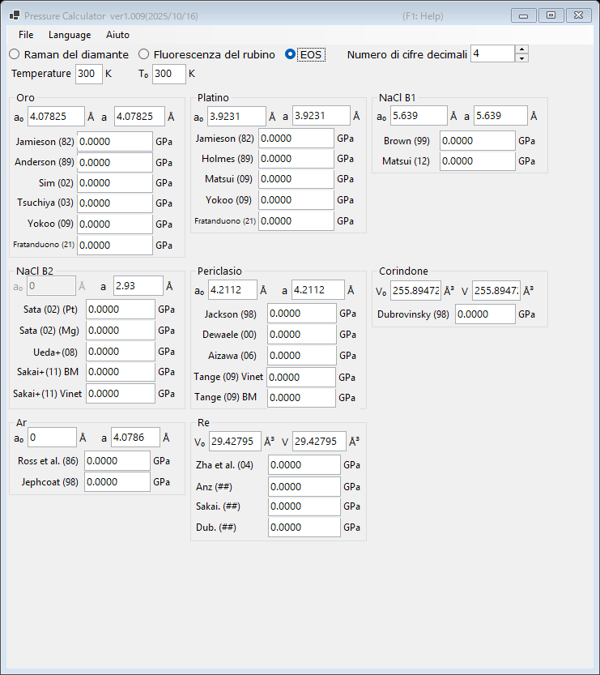

# 3. Equazione di stato (EOS)

La pressione viene determinata dalla costante reticolare misurata (o dal volume della cella unitaria) di un materiale standard, utilizzando equazioni di stato pubblicate. È il metodo standard negli esperimenti di diffrazione dei raggi X ad alta pressione. Selezionare **EOS** nella parte superiore della finestra principale.

{width=700px}

## Procedura

1. Inserire la temperatura di misura **Temperature** e la temperatura di riferimento **T₀** (in K). Le equazioni di stato termiche le utilizzano; le scale a temperatura ambiente ignorano la differenza.
2. Per ciascun materiale standard, inserire la costante reticolare a pressione ambiente **a₀** (Å) e la costante reticolare misurata **a** (Å). Per il corindone e il renio si inseriscono invece i volumi della cella unitaria **V₀** e **V** (ų).
3. La pressione calcolata con ciascuna scala pubblicata è visualizzata immediatamente (in GPa).

## Standard e scale disponibili

| Materiale | Scale |
|---|---|
| Oro | Jamieson (1982), Anderson (1989), Shim (2002), Tsuchiya (2003), Yokoo (2009), Fratanduono (2021) |
| Platino | Jamieson (1982), Holmes (1989), Matsui (2009), Yokoo (2009), Fratanduono (2021) |
| NaCl B1 | Brown (1999), Matsui (2012) |
| NaCl B2 | Sata (2002) (riferimenti di pressione Pt/Mg), Ueda+ (2008), Sakai+ (2011) BM/Vinet |
| Periclasio (MgO) | Jackson (1998), Dewaele (2000), Aizawa (2006), Tange (2009) Vinet/BM |
| Corindone (Al₂O₃) | Dubrovinsky (1998) |
| Ar | Ross et al. (1986), Jephcoat (1998) |
| Re | Zha et al. (2004) e altri |
| Mo | Zhao+ (2000), Huang+ (2016) MGD |
| Pb | Strässle+ (2014) |

!!! note
    Scale diverse per lo stesso materiale possono discostarsi di alcuni punti percentuali, in particolare alle pressioni dei multimegabar. Nel pubblicare i risultati, indicare quale scala è stata utilizzata.

## Intervallo di temperatura di validità

Ogni scala è valida solo in un certo intervallo di temperatura. Quando **Temperature** (per Pb anche **T₀**) è fuori dall'intervallo di una scala, la sua pressione viene mostrata in rosso, a destra di **T₀** compare il messaggio «⚠ In rosso: …» e il tooltip del valore indica l'intervallo valido. La pressione viene comunque calcolata (estrapolata) e non viene modificata.

| Materiale | Scala | Intervallo valido | Fondamento |
|---|---|---|---|
| Oro | Jamieson (1982) | 200–1500 K | intervallo della tabella pubblicata (estrapolata al di fuori) |
| Oro | Anderson (1989) | ≥ 300 K | pressione termica lineare in (T − 300 K); non fisica al di sotto della temperatura ambiente |
| Oro | Shim (2002) | — | pressione termica di Mie–Grüneisen–Debye; nessun intervallo impostato (nessun avviso) |
| Oro | Tsuchiya (2003) | 300–2500 K | intervallo della tabella pubblicata (estrapolata al di fuori) |
| Oro | Yokoo (2009) | 0–3000 K | intervallo della tabella pubblicata (estrapolata al di fuori) |
| Oro | Fratanduono (2021) | 290–310 K | isoterma a temperatura ambiente (300 K); la temperatura non viene usata |
| Platino | Jamieson (1982) | 200–1500 K | intervallo della tabella pubblicata (estrapolata al di fuori) |
| Platino | Holmes (1989) | ≥ 300 K | pressione termica lineare in (T − 300 K); non fisica al di sotto della temperatura ambiente |
| Platino | Matsui (2009) | ≤ 3000 K | indicato dagli autori (fino a 3000 K e 300 GPa) |
| Platino | Yokoo (2009) | 0–3000 K | intervallo della tabella pubblicata (estrapolata al di fuori) |
| Platino | Fratanduono (2021) | 290–310 K | isoterma a temperatura ambiente (300 K); la temperatura non viene usata |
| NaCl B1 | Brown (1999) | 300–1200 K | intervallo della tabella pubblicata (estrapolata al di fuori) |
| NaCl B1 | Matsui (2012) | — | pressione termica di Mie–Grüneisen–Debye; nessun intervallo impostato (nessun avviso) |
| NaCl B2 | Sata (2002) (Pt), (Mg) | 290–310 K | isoterma a temperatura ambiente (300 K); la temperatura non viene usata |
| NaCl B2 | Ueda+ (2008) | ≥ 300 K | pressione termica lineare in (T − 300 K); non fisica al di sotto della temperatura ambiente |
| NaCl B2 | Sakai+ (2011) BM, Vinet | 290–310 K | isoterma a temperatura ambiente (300 K); la temperatura non viene usata |
| Periclasio (MgO) | Jackson (1998), Dewaele (2000), Aizawa (2006), Tange (2009) Vinet/BM | — | pressione termica di Mie–Grüneisen–Debye; nessun intervallo impostato (nessun avviso) |
| Corindone (Al₂O₃) | Dubrovinsky (1998) | ≥ 300 K | fit ad alta temperatura dell'espansione termica e di K(T); non fisico al di sotto della temperatura ambiente |
| Ar | Ross et al. (1986) | 290–310 K | isoterma a temperatura ambiente (300 K); la temperatura non viene usata |
| Ar | Jephcoat (1998) | — | pressione termica di Mie–Grüneisen–Debye; nessun intervallo impostato (nessun avviso) |
| Re | Zha et al. (2004) | 300–3000 K | intervallo della tabella pubblicata (estrapolata al di fuori) |
| Re | Anz (##), Sakai. (##), Dub. (##) | 290–310 K | isoterma a temperatura ambiente (300 K); la temperatura non viene usata |
| Mo | Zhao+ (2000) | ≥ 300 K | fit ad alta temperatura dell'espansione termica e di K(T); non fisico al di sotto della temperatura ambiente |
| Mo | Huang+ (2016) MGD | — | pressione termica di Mie–Grüneisen–Debye; nessun intervallo impostato (nessun avviso) |
| Pb | Strässle+ (2014) | T: 0–300 K, T₀: 0–310 K | intervallo della tabella pubblicata (estrapolata al di fuori) |

Per le isoterme a 300 K l'avviso non compare tra 290 e 310 K, così che un valore a temperatura ambiente come 295 K non lo attivi. Anche le scale del Re indicate nella finestra come «Anz», «Sakai.» e «Dub.» sono isoterme a 300 K.
