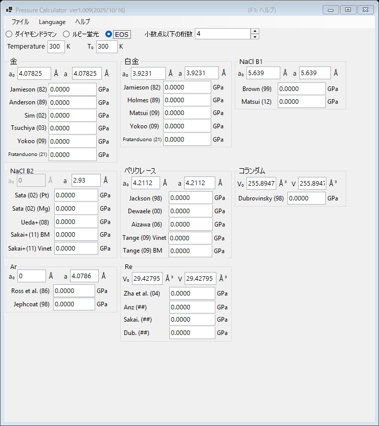

# 3. 状態方程式 (EOS)

公表されている状態方程式を用いて、標準物質の格子定数（または単位胞体積）の測定値から圧力を決定します。高圧下の X 線回折実験における標準的な方法です。メインウィンドウ上部の **EOS** を選択してください。

{width=700px}

## 操作の流れ

1. 測定温度 **Temperature** と参照温度 **T₀** を入力します (K)。熱的状態方程式ではこれらが使われます（室温スケールでは差は無視されます）。
2. 各標準物質について、常圧での格子定数 **a₀** (Å) と測定された格子定数 **a** (Å) を入力します。コランダムとレニウムでは代わりに単位胞体積 **V₀**・**V** (ų) を入力します。
3. 各スケールで計算された圧力が即座に表示されます (GPa)。

## 利用可能な標準物質とスケール

| 物質 | スケール |
|---|---|
| 金 | Jamieson (1982), Anderson (1989), Shim (2002), Tsuchiya (2003), Yokoo (2009), Fratanduono (2021) |
| 白金 | Jamieson (1982), Holmes (1989), Matsui (2009), Yokoo (2009), Fratanduono (2021) |
| NaCl B1 | Brown (1999), Matsui (2012) |
| NaCl B2 | Sata (2002) (Pt/Mg 圧力基準), Ueda+ (2008), Sakai+ (2011) BM/Vinet |
| ペリクレース (MgO) | Jackson (1998), Dewaele (2000), Aizawa (2006), Tange (2009) Vinet/BM |
| コランダム (Al₂O₃) | Dubrovinsky (1998) |
| Ar | Ross et al. (1986), Jephcoat (1998) |
| Re | Zha et al. (2004) ほか |
| Mo | Zhao+ (2000), Huang+ (2016) MGD |
| Pb | Strässle+ (2014) |

!!! note
    同じ物質でもスケールによって、特に数百 GPa 領域では数 % 程度の差が生じることがあります。結果を公表する際は、どのスケールを使用したかを明記してください。

## 適用温度範囲

各スケールは決まった温度範囲でのみ有効です。**Temperature** (Pb では **T₀** も) がスケールの範囲外のとき、そのスケールの圧力を赤字で表示し、**T₀** の右に「⚠ 赤字: …」を表示します。値にマウスを置くとツールチップに有効範囲が表示されます。圧力そのものは (外挿で) 計算しており、値は変えていません。

| 物質 | スケール | 有効範囲 | 根拠 |
|---|---|---|---|
| 金 | Jamieson (1982) | 200–1500 K | 公表された表の範囲 (範囲外は外挿) |
| 金 | Anderson (1989) | ≥ 300 K | 熱圧力が (T − 300 K) に比例。室温より低温では物理的でない |
| 金 | Shim (2002) | — | Mie–Grüneisen–Debye の熱圧力。範囲は設けていない (警告なし) |
| 金 | Tsuchiya (2003) | 300–2500 K | 公表された表の範囲 (範囲外は外挿) |
| 金 | Yokoo (2009) | 0–3000 K | 公表された表の範囲 (範囲外は外挿) |
| 金 | Fratanduono (2021) | 290–310 K | 室温 (300 K) の等温式。温度は使わない |
| 白金 | Jamieson (1982) | 200–1500 K | 公表された表の範囲 (範囲外は外挿) |
| 白金 | Holmes (1989) | ≥ 300 K | 熱圧力が (T − 300 K) に比例。室温より低温では物理的でない |
| 白金 | Matsui (2009) | ≤ 3000 K | 著者が示す範囲 (3000 K・300 GPa まで) |
| 白金 | Yokoo (2009) | 0–3000 K | 公表された表の範囲 (範囲外は外挿) |
| 白金 | Fratanduono (2021) | 290–310 K | 室温 (300 K) の等温式。温度は使わない |
| NaCl B1 | Brown (1999) | 300–1200 K | 公表された表の範囲 (範囲外は外挿) |
| NaCl B1 | Matsui (2012) | — | Mie–Grüneisen–Debye の熱圧力。範囲は設けていない (警告なし) |
| NaCl B2 | Sata (2002) (Pt), (Mg) | 290–310 K | 室温 (300 K) の等温式。温度は使わない |
| NaCl B2 | Ueda+ (2008) | ≥ 300 K | 熱圧力が (T − 300 K) に比例。室温より低温では物理的でない |
| NaCl B2 | Sakai+ (2011) BM, Vinet | 290–310 K | 室温 (300 K) の等温式。温度は使わない |
| ペリクレース (MgO) | Jackson (1998), Dewaele (2000), Aizawa (2006), Tange (2009) Vinet/BM | — | Mie–Grüneisen–Debye の熱圧力。範囲は設けていない (警告なし) |
| コランダム (Al₂O₃) | Dubrovinsky (1998) | ≥ 300 K | 熱膨張と K(T) の高温での近似式。室温より低温では物理的でない |
| Ar | Ross et al. (1986) | 290–310 K | 室温 (300 K) の等温式。温度は使わない |
| Ar | Jephcoat (1998) | — | Mie–Grüneisen–Debye の熱圧力。範囲は設けていない (警告なし) |
| Re | Zha et al. (2004) | 300–3000 K | 公表された表の範囲 (範囲外は外挿) |
| Re | Anz (##), Sakai. (##), Dub. (##) | 290–310 K | 室温 (300 K) の等温式。温度は使わない |
| Mo | Zhao+ (2000) | ≥ 300 K | 熱膨張と K(T) の高温での近似式。室温より低温では物理的でない |
| Mo | Huang+ (2016) MGD | — | Mie–Grüneisen–Debye の熱圧力。範囲は設けていない (警告なし) |
| Pb | Strässle+ (2014) | T: 0–300 K, T₀: 0–310 K | 公表された表の範囲 (範囲外は外挿) |

300 K の等温式では、室温の入力 (295 K など) で警告が出ないよう、290–310 K の間は警告を出しません。画面で「Anz」「Sakai.」「Dub.」と表示される Re のスケールも 300 K の等温式です。
