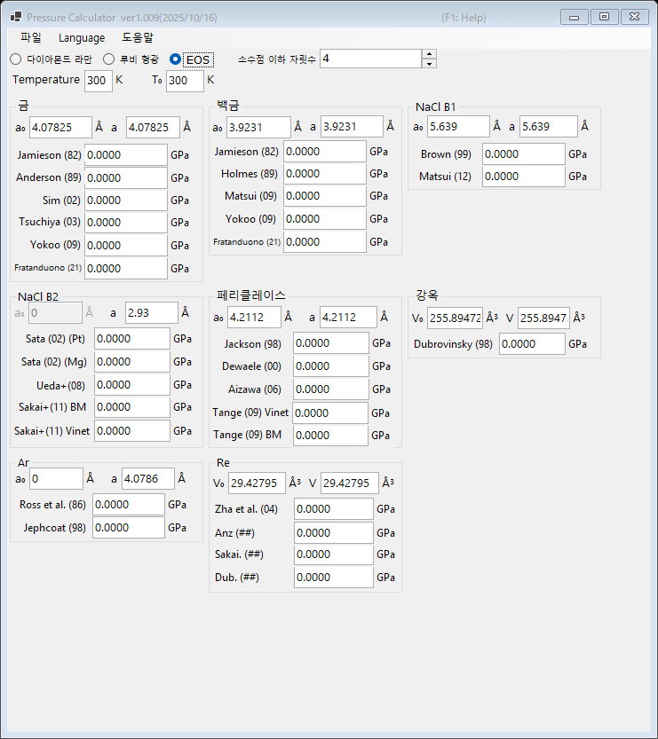

# 3. 상태방정식 (EOS)

발표된 상태방정식을 이용하여 표준 물질의 격자 상수(또는 단위포 부피) 측정값으로부터 압력을 결정합니다. 고압 X선 회절 실험에서 표준적으로 쓰이는 방법입니다. 메인 창 상단에서 **EOS**를 선택하십시오.

{width=700px}

## 작업 절차

1. 측정 온도 **Temperature**와 기준 온도 **T₀**를 입력합니다 (K 단위). 열 상태방정식은 이 값을 사용하며, 상온 스케일에서는 온도 차이가 무시됩니다.
2. 각 표준 물질에 대해 상압에서의 격자 상수 **a₀** (Å)와 측정된 격자 상수 **a** (Å)를 입력합니다. 강옥과 레늄은 대신 단위포 부피 **V₀**·**V** (ų)를 입력합니다.
3. 발표된 각 스케일로 계산된 압력이 즉시 표시됩니다 (GPa 단위).

## 사용 가능한 표준 물질과 스케일

| 물질 | 스케일 |
|---|---|
| 금 | Jamieson (1982), Anderson (1989), Shim (2002), Tsuchiya (2003), Yokoo (2009), Fratanduono (2021) |
| 백금 | Jamieson (1982), Holmes (1989), Matsui (2009), Yokoo (2009), Fratanduono (2021) |
| NaCl B1 | Brown (1999), Matsui (2012) |
| NaCl B2 | Sata (2002) (Pt/Mg 압력 기준), Ueda+ (2008), Sakai+ (2011) BM/Vinet |
| 페리클레이스 (MgO) | Jackson (1998), Dewaele (2000), Aizawa (2006), Tange (2009) Vinet/BM |
| 강옥 (Al₂O₃) | Dubrovinsky (1998) |
| Ar | Ross et al. (1986), Jephcoat (1998) |
| Re | Zha et al. (2004) 외 |
| Mo | Zhao+ (2000), Huang+ (2016) MGD |
| Pb | Strässle+ (2014) |

!!! note
    같은 물질이라도 스케일에 따라, 특히 수백 GPa(멀티메가바) 영역에서는 몇 % 정도의 차이가 생길 수 있습니다. 결과를 발표할 때는 어떤 스케일을 사용했는지 명시해 주십시오.

## 적용 온도 범위

각 스케일은 정해진 온도 범위에서만 유효합니다. **Temperature**(Pb는 **T₀**도)가 스케일의 범위를 벗어나면 그 스케일의 압력이 빨간색으로 표시되고, **T₀** 오른쪽에 “⚠ 빨간색: …” 메시지가 나타나며, 값의 툴팁에 유효 범위가 표시됩니다. 압력 자체는 그대로(외삽하여) 계산되며 값은 변경되지 않습니다.

| 물질 | 스케일 | 유효 범위 | 근거 |
|---|---|---|---|
| 금 | Jamieson (1982) | 200–1500 K | 발표된 표의 범위 (범위 밖은 외삽) |
| 금 | Anderson (1989) | ≥ 300 K | 열압력이 (T − 300 K)에 선형; 실온 이하에서는 물리적이지 않음 |
| 금 | Shim (2002) | — | Mie–Grüneisen–Debye 열압력; 범위를 설정하지 않음 (경고 없음) |
| 금 | Tsuchiya (2003) | 300–2500 K | 발표된 표의 범위 (범위 밖은 외삽) |
| 금 | Yokoo (2009) | 0–3000 K | 발표된 표의 범위 (범위 밖은 외삽) |
| 금 | Fratanduono (2021) | 290–310 K | 실온(300 K) 등온식; 온도를 사용하지 않음 |
| 백금 | Jamieson (1982) | 200–1500 K | 발표된 표의 범위 (범위 밖은 외삽) |
| 백금 | Holmes (1989) | ≥ 300 K | 열압력이 (T − 300 K)에 선형; 실온 이하에서는 물리적이지 않음 |
| 백금 | Matsui (2009) | ≤ 3000 K | 저자가 제시한 범위 (3000 K, 300 GPa까지) |
| 백금 | Yokoo (2009) | 0–3000 K | 발표된 표의 범위 (범위 밖은 외삽) |
| 백금 | Fratanduono (2021) | 290–310 K | 실온(300 K) 등온식; 온도를 사용하지 않음 |
| NaCl B1 | Brown (1999) | 300–1200 K | 발표된 표의 범위 (범위 밖은 외삽) |
| NaCl B1 | Matsui (2012) | — | Mie–Grüneisen–Debye 열압력; 범위를 설정하지 않음 (경고 없음) |
| NaCl B2 | Sata (2002) (Pt), (Mg) | 290–310 K | 실온(300 K) 등온식; 온도를 사용하지 않음 |
| NaCl B2 | Ueda+ (2008) | ≥ 300 K | 열압력이 (T − 300 K)에 선형; 실온 이하에서는 물리적이지 않음 |
| NaCl B2 | Sakai+ (2011) BM, Vinet | 290–310 K | 실온(300 K) 등온식; 온도를 사용하지 않음 |
| 페리클레이스 (MgO) | Jackson (1998), Dewaele (2000), Aizawa (2006), Tange (2009) Vinet/BM | — | Mie–Grüneisen–Debye 열압력; 범위를 설정하지 않음 (경고 없음) |
| 강옥 (Al₂O₃) | Dubrovinsky (1998) | ≥ 300 K | 열팽창과 K(T)의 고온 피팅식; 실온 이하에서는 물리적이지 않음 |
| Ar | Ross et al. (1986) | 290–310 K | 실온(300 K) 등온식; 온도를 사용하지 않음 |
| Ar | Jephcoat (1998) | — | Mie–Grüneisen–Debye 열압력; 범위를 설정하지 않음 (경고 없음) |
| Re | Zha et al. (2004) | 300–3000 K | 발표된 표의 범위 (범위 밖은 외삽) |
| Re | Anz (##), Sakai. (##), Dub. (##) | 290–310 K | 실온(300 K) 등온식; 온도를 사용하지 않음 |
| Mo | Zhao+ (2000) | ≥ 300 K | 열팽창과 K(T)의 고온 피팅식; 실온 이하에서는 물리적이지 않음 |
| Mo | Huang+ (2016) MGD | — | Mie–Grüneisen–Debye 열압력; 범위를 설정하지 않음 (경고 없음) |
| Pb | Strässle+ (2014) | T: 0–300 K, T₀: 0–310 K | 발표된 표의 범위 (범위 밖은 외삽) |

300 K 등온식은 실온 입력(예: 295 K)으로 경고가 나오지 않도록 290–310 K 사이에서는 경고를 표시하지 않습니다. 창에 “Anz”, “Sakai.”, “Dub.”로 표시되는 Re 스케일도 300 K 등온식입니다.
