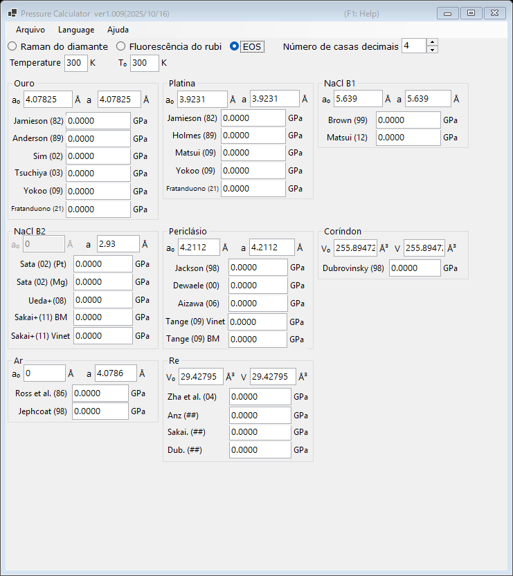

# 3. Equação de estado (EOS)

A pressão é determinada a partir do parâmetro de rede (ou do volume da célula unitária) medido de um material padrão, usando equações de estado publicadas. Esse é o método padrão em experimentos de difração de raios X sob alta pressão. Selecione **EOS** na parte superior da janela principal.

{width=700px}

## Fluxo de trabalho

1. Insira a temperatura de medição **Temperature** e a temperatura de referência **T₀** (em K). As equações de estado térmicas as utilizam; as escalas à temperatura ambiente ignoram a diferença.
2. Para cada material padrão, insira o parâmetro de rede em condições ambientes **a₀** (Å) e o parâmetro de rede medido **a** (Å). Para o coríndon e o rênio, são inseridos, em vez disso, os volumes da célula unitária **V₀** e **V** (ų).
3. A pressão calculada com cada escala publicada é exibida imediatamente (em GPa).

## Padrões e escalas disponíveis

| Material | Escalas |
|---|---|
| Ouro | Jamieson (1982), Anderson (1989), Shim (2002), Tsuchiya (2003), Yokoo (2009), Fratanduono (2021) |
| Platina | Jamieson (1982), Holmes (1989), Matsui (2009), Yokoo (2009), Fratanduono (2021) |
| NaCl B1 | Brown (1999), Matsui (2012) |
| NaCl B2 | Sata (2002) (referências de pressão Pt/Mg), Ueda+ (2008), Sakai+ (2011) BM/Vinet |
| Periclásio (MgO) | Jackson (1998), Dewaele (2000), Aizawa (2006), Tange (2009) Vinet/BM |
| Coríndon (Al₂O₃) | Dubrovinsky (1998) |
| Ar | Ross et al. (1986), Jephcoat (1998) |
| Re | Zha et al. (2004) e outros |
| Mo | Zhao+ (2000), Huang+ (2016) MGD |
| Pb | Strässle+ (2014) |

!!! note
    Escalas diferentes para o mesmo material podem diferir em vários por cento, especialmente em pressões de vários megabars. Informe qual escala foi usada ao publicar os resultados.

## Intervalo de temperatura de validade

Cada escala só é válida em um certo intervalo de temperatura. Quando **Temperature** (para Pb, também **T₀**) está fora do intervalo de uma escala, sua pressão é mostrada em vermelho, a mensagem “⚠ Em vermelho: …” aparece à direita de **T₀** e a dica de ferramenta do valor indica o intervalo válido. A pressão continua sendo calculada (extrapolada) e não é alterada.

| Material | Escala | Intervalo válido | Fundamento |
|---|---|---|---|
| Ouro | Jamieson (1982) | 200–1500 K | intervalo da tabela publicada (extrapolada fora dele) |
| Ouro | Anderson (1989) | ≥ 300 K | pressão térmica linear em (T − 300 K); não é física abaixo da temperatura ambiente |
| Ouro | Shim (2002) | — | pressão térmica de Mie–Grüneisen–Debye; sem intervalo definido (sem aviso) |
| Ouro | Tsuchiya (2003) | 300–2500 K | intervalo da tabela publicada (extrapolada fora dele) |
| Ouro | Yokoo (2009) | 0–3000 K | intervalo da tabela publicada (extrapolada fora dele) |
| Ouro | Fratanduono (2021) | 290–310 K | isoterma à temperatura ambiente (300 K); a temperatura não é usada |
| Platina | Jamieson (1982) | 200–1500 K | intervalo da tabela publicada (extrapolada fora dele) |
| Platina | Holmes (1989) | ≥ 300 K | pressão térmica linear em (T − 300 K); não é física abaixo da temperatura ambiente |
| Platina | Matsui (2009) | ≤ 3000 K | indicado pelos autores (até 3000 K e 300 GPa) |
| Platina | Yokoo (2009) | 0–3000 K | intervalo da tabela publicada (extrapolada fora dele) |
| Platina | Fratanduono (2021) | 290–310 K | isoterma à temperatura ambiente (300 K); a temperatura não é usada |
| NaCl B1 | Brown (1999) | 300–1200 K | intervalo da tabela publicada (extrapolada fora dele) |
| NaCl B1 | Matsui (2012) | — | pressão térmica de Mie–Grüneisen–Debye; sem intervalo definido (sem aviso) |
| NaCl B2 | Sata (2002) (Pt), (Mg) | 290–310 K | isoterma à temperatura ambiente (300 K); a temperatura não é usada |
| NaCl B2 | Ueda+ (2008) | ≥ 300 K | pressão térmica linear em (T − 300 K); não é física abaixo da temperatura ambiente |
| NaCl B2 | Sakai+ (2011) BM, Vinet | 290–310 K | isoterma à temperatura ambiente (300 K); a temperatura não é usada |
| Periclásio (MgO) | Jackson (1998), Dewaele (2000), Aizawa (2006), Tange (2009) Vinet/BM | — | pressão térmica de Mie–Grüneisen–Debye; sem intervalo definido (sem aviso) |
| Coríndon (Al₂O₃) | Dubrovinsky (1998) | ≥ 300 K | ajuste em alta temperatura da expansão térmica e de K(T); não é físico abaixo da temperatura ambiente |
| Ar | Ross et al. (1986) | 290–310 K | isoterma à temperatura ambiente (300 K); a temperatura não é usada |
| Ar | Jephcoat (1998) | — | pressão térmica de Mie–Grüneisen–Debye; sem intervalo definido (sem aviso) |
| Re | Zha et al. (2004) | 300–3000 K | intervalo da tabela publicada (extrapolada fora dele) |
| Re | Anz (##), Sakai. (##), Dub. (##) | 290–310 K | isoterma à temperatura ambiente (300 K); a temperatura não é usada |
| Mo | Zhao+ (2000) | ≥ 300 K | ajuste em alta temperatura da expansão térmica e de K(T); não é físico abaixo da temperatura ambiente |
| Mo | Huang+ (2016) MGD | — | pressão térmica de Mie–Grüneisen–Debye; sem intervalo definido (sem aviso) |
| Pb | Strässle+ (2014) | T: 0–300 K, T₀: 0–310 K | intervalo da tabela publicada (extrapolada fora dele) |

Nas isotermas de 300 K o aviso não aparece entre 290 e 310 K, para que uma entrada à temperatura ambiente como 295 K não o acione. As escalas de Re rotuladas “Anz”, “Sakai.” e “Dub.” na janela também são isotermas de 300 K.
