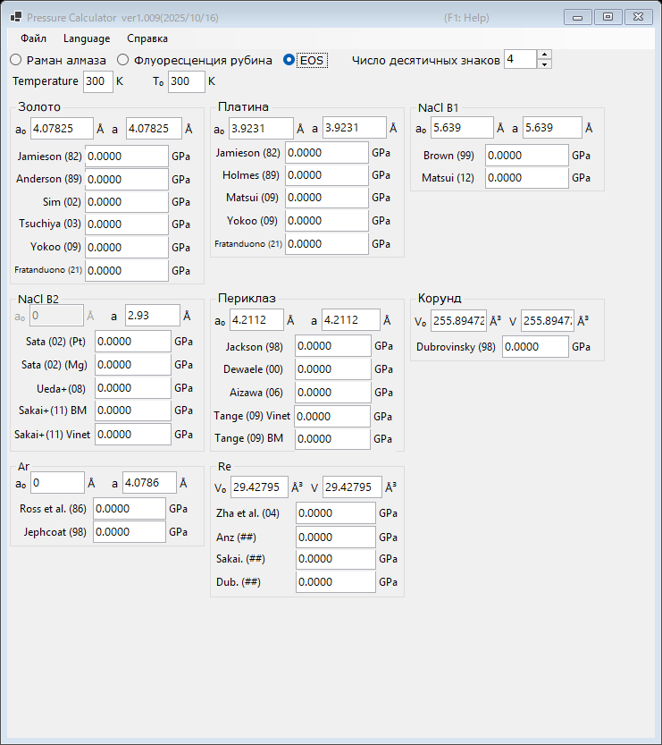

# 3. Уравнение состояния (EOS)

Давление определяется по измеренному параметру решетки (или объему элементарной ячейки) стандартного материала с использованием опубликованных уравнений состояния. Это стандартный метод в рентгенодифракционных экспериментах при высоких давлениях. Выберите **EOS** в верхней части главного окна.

{width=700px}

## Порядок работы

1. Введите температуру измерения **Temperature** и эталонную температуру **T₀** (в K). Термические уравнения состояния используют эти значения; шкалы для комнатной температуры игнорируют их различие.
2. Для каждого стандартного материала введите параметр решетки при атмосферном давлении **a₀** (Å) и измеренный параметр решетки **a** (Å). Для корунда и рения вместо этого вводятся объемы элементарной ячейки **V₀** и **V** (ų).
3. Давление, рассчитанное по каждой опубликованной шкале, отображается сразу же (в GPa).

## Доступные стандартные материалы и шкалы

| Материал | Шкалы |
|---|---|
| Золото | Jamieson (1982), Anderson (1989), Shim (2002), Tsuchiya (2003), Yokoo (2009), Fratanduono (2021) |
| Платина | Jamieson (1982), Holmes (1989), Matsui (2009), Yokoo (2009), Fratanduono (2021) |
| NaCl B1 | Brown (1999), Matsui (2012) |
| NaCl B2 | Sata (2002) (реперы давления Pt/Mg), Ueda+ (2008), Sakai+ (2011) BM/Vinet |
| Периклаз (MgO) | Jackson (1998), Dewaele (2000), Aizawa (2006), Tange (2009) Vinet/BM |
| Корунд (Al₂O₃) | Dubrovinsky (1998) |
| Ar | Ross et al. (1986), Jephcoat (1998) |
| Re | Zha et al. (2004) и другие |
| Mo | Zhao+ (2000), Huang+ (2016) MGD |
| Pb | Strässle+ (2014) |

!!! note
    Разные шкалы для одного и того же материала могут расходиться на несколько процентов, особенно при мультимегабарных давлениях. При публикации результатов указывайте, какая шкала была использована.

## Температурная область применимости

Каждая шкала применима только в определенном диапазоне температур. Если **Temperature** (для Pb также **T₀**) выходит за диапазон шкалы, ее давление показывается красным, справа от **T₀** появляется сообщение «⚠ Красным: …», а всплывающая подсказка значения показывает допустимый диапазон. Само давление по-прежнему вычисляется (экстраполяцией) и не изменяется.

| Материал | Шкала | Допустимый диапазон | Основание |
|---|---|---|---|
| Золото | Jamieson (1982) | 200–1500 K | диапазон опубликованной таблицы (вне его — экстраполяция) |
| Золото | Anderson (1989) | ≥ 300 K | тепловое давление линейно по (T − 300 K); ниже комнатной температуры не имеет физического смысла |
| Золото | Shim (2002) | — | тепловое давление по Ми–Грюнайзену–Дебаю; диапазон не задан (без предупреждения) |
| Золото | Tsuchiya (2003) | 300–2500 K | диапазон опубликованной таблицы (вне его — экстраполяция) |
| Золото | Yokoo (2009) | 0–3000 K | диапазон опубликованной таблицы (вне его — экстраполяция) |
| Золото | Fratanduono (2021) | 290–310 K | изотерма при комнатной температуре (300 K); температура не используется |
| Платина | Jamieson (1982) | 200–1500 K | диапазон опубликованной таблицы (вне его — экстраполяция) |
| Платина | Holmes (1989) | ≥ 300 K | тепловое давление линейно по (T − 300 K); ниже комнатной температуры не имеет физического смысла |
| Платина | Matsui (2009) | ≤ 3000 K | указано авторами (до 3000 K и 300 GPa) |
| Платина | Yokoo (2009) | 0–3000 K | диапазон опубликованной таблицы (вне его — экстраполяция) |
| Платина | Fratanduono (2021) | 290–310 K | изотерма при комнатной температуре (300 K); температура не используется |
| NaCl B1 | Brown (1999) | 300–1200 K | диапазон опубликованной таблицы (вне его — экстраполяция) |
| NaCl B1 | Matsui (2012) | — | тепловое давление по Ми–Грюнайзену–Дебаю; диапазон не задан (без предупреждения) |
| NaCl B2 | Sata (2002) (Pt), (Mg) | 290–310 K | изотерма при комнатной температуре (300 K); температура не используется |
| NaCl B2 | Ueda+ (2008) | ≥ 300 K | тепловое давление линейно по (T − 300 K); ниже комнатной температуры не имеет физического смысла |
| NaCl B2 | Sakai+ (2011) BM, Vinet | 290–310 K | изотерма при комнатной температуре (300 K); температура не используется |
| Периклаз (MgO) | Jackson (1998), Dewaele (2000), Aizawa (2006), Tange (2009) Vinet/BM | — | тепловое давление по Ми–Грюнайзену–Дебаю; диапазон не задан (без предупреждения) |
| Корунд (Al₂O₃) | Dubrovinsky (1998) | ≥ 300 K | высокотемпературная аппроксимация теплового расширения и K(T); ниже комнатной температуры не имеет физического смысла |
| Ar | Ross et al. (1986) | 290–310 K | изотерма при комнатной температуре (300 K); температура не используется |
| Ar | Jephcoat (1998) | — | тепловое давление по Ми–Грюнайзену–Дебаю; диапазон не задан (без предупреждения) |
| Re | Zha et al. (2004) | 300–3000 K | диапазон опубликованной таблицы (вне его — экстраполяция) |
| Re | Anz (##), Sakai. (##), Dub. (##) | 290–310 K | изотерма при комнатной температуре (300 K); температура не используется |
| Mo | Zhao+ (2000) | ≥ 300 K | высокотемпературная аппроксимация теплового расширения и K(T); ниже комнатной температуры не имеет физического смысла |
| Mo | Huang+ (2016) MGD | — | тепловое давление по Ми–Грюнайзену–Дебаю; диапазон не задан (без предупреждения) |
| Pb | Strässle+ (2014) | T: 0–300 K, T₀: 0–310 K | диапазон опубликованной таблицы (вне его — экстраполяция) |

Для изотерм 300 K предупреждение не выводится в диапазоне 290–310 K, чтобы ввод комнатной температуры, например 295 K, его не вызывал. Шкалы Re, обозначенные в окне как «Anz», «Sakai.» и «Dub.», также являются изотермами 300 K.
