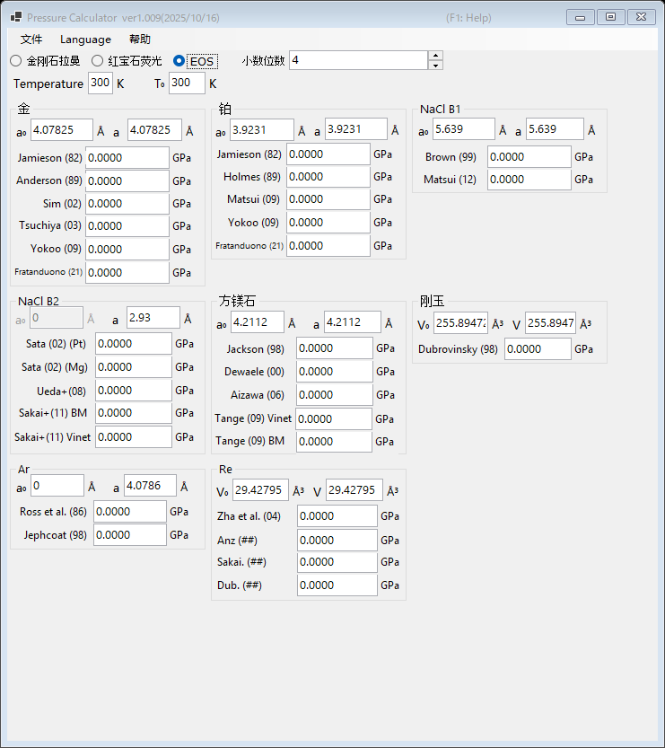

# 3. 状态方程 (EOS)

利用已发表的状态方程，由标准物质晶格常数（或晶胞体积）的测量值确定压力。这是高压 X 射线衍射实验中的标准方法。请在主窗口顶部选择 **EOS**。

{width=700px}

## 操作流程

1. 输入测量温度 **Temperature** 和参考温度 **T₀**（单位 K）。热状态方程会使用这两个温度；室温压标则忽略其差异。
2. 对每种标准物质，输入常压下的晶格常数 **a₀** (Å) 和测得的晶格常数 **a** (Å)。刚玉和铼则改为输入晶胞体积 **V₀** 和 **V** (ų)。
3. 各已发表压标计算出的压力会立即显示（单位 GPa）。

## 可用的标准物质与压标

| 物质 | 压标 |
|---|---|
| 金 | Jamieson (1982), Anderson (1989), Shim (2002), Tsuchiya (2003), Yokoo (2009), Fratanduono (2021) |
| 铂 | Jamieson (1982), Holmes (1989), Matsui (2009), Yokoo (2009), Fratanduono (2021) |
| NaCl B1 | Brown (1999), Matsui (2012) |
| NaCl B2 | Sata (2002)（Pt/Mg 压力参考）, Ueda+ (2008), Sakai+ (2011) BM/Vinet |
| 方镁石 (MgO) | Jackson (1998), Dewaele (2000), Aizawa (2006), Tange (2009) Vinet/BM |
| 刚玉 (Al₂O₃) | Dubrovinsky (1998) |
| Ar | Ross et al. (1986), Jephcoat (1998) |
| Re | Zha et al. (2004) 等 |
| Mo | Zhao+ (2000), Huang+ (2016) MGD |
| Pb | Strässle+ (2014) |

!!! note
    同一物质的不同压标之间可能相差百分之几，在数百 GPa 压力下尤为明显。发表结果时请注明所使用的压标。

## 适用温度范围

每个压标只在一定的温度范围内有效。当 **Temperature**（Pb 还包括 **T₀**）超出某压标的范围时，该压标的压力以红色显示，**T₀** 右侧会出现“⚠ 红色：…”提示，数值的工具提示会给出有效范围。压力本身仍照常（外推）计算，数值不作更改。

| 物质 | 压标 | 有效范围 | 依据 |
|---|---|---|---|
| 金 | Jamieson (1982) | 200–1500 K | 已发表数据表的范围（范围外为外推） |
| 金 | Anderson (1989) | ≥ 300 K | 热压力与 (T − 300 K) 成线性；在室温以下没有物理意义 |
| 金 | Shim (2002) | — | Mie–Grüneisen–Debye 热压力；未设定范围（不警告） |
| 金 | Tsuchiya (2003) | 300–2500 K | 已发表数据表的范围（范围外为外推） |
| 金 | Yokoo (2009) | 0–3000 K | 已发表数据表的范围（范围外为外推） |
| 金 | Fratanduono (2021) | 290–310 K | 室温（300 K）等温线；不使用温度 |
| 铂 | Jamieson (1982) | 200–1500 K | 已发表数据表的范围（范围外为外推） |
| 铂 | Holmes (1989) | ≥ 300 K | 热压力与 (T − 300 K) 成线性；在室温以下没有物理意义 |
| 铂 | Matsui (2009) | ≤ 3000 K | 作者给出的范围（至 3000 K、300 GPa） |
| 铂 | Yokoo (2009) | 0–3000 K | 已发表数据表的范围（范围外为外推） |
| 铂 | Fratanduono (2021) | 290–310 K | 室温（300 K）等温线；不使用温度 |
| NaCl B1 | Brown (1999) | 300–1200 K | 已发表数据表的范围（范围外为外推） |
| NaCl B1 | Matsui (2012) | — | Mie–Grüneisen–Debye 热压力；未设定范围（不警告） |
| NaCl B2 | Sata (2002) (Pt), (Mg) | 290–310 K | 室温（300 K）等温线；不使用温度 |
| NaCl B2 | Ueda+ (2008) | ≥ 300 K | 热压力与 (T − 300 K) 成线性；在室温以下没有物理意义 |
| NaCl B2 | Sakai+ (2011) BM, Vinet | 290–310 K | 室温（300 K）等温线；不使用温度 |
| 方镁石 (MgO) | Jackson (1998), Dewaele (2000), Aizawa (2006), Tange (2009) Vinet/BM | — | Mie–Grüneisen–Debye 热压力；未设定范围（不警告） |
| 刚玉 (Al₂O₃) | Dubrovinsky (1998) | ≥ 300 K | 热膨胀与 K(T) 的高温拟合式；在室温以下没有物理意义 |
| Ar | Ross et al. (1986) | 290–310 K | 室温（300 K）等温线；不使用温度 |
| Ar | Jephcoat (1998) | — | Mie–Grüneisen–Debye 热压力；未设定范围（不警告） |
| Re | Zha et al. (2004) | 300–3000 K | 已发表数据表的范围（范围外为外推） |
| Re | Anz (##), Sakai. (##), Dub. (##) | 290–310 K | 室温（300 K）等温线；不使用温度 |
| Mo | Zhao+ (2000) | ≥ 300 K | 热膨胀与 K(T) 的高温拟合式；在室温以下没有物理意义 |
| Mo | Huang+ (2016) MGD | — | Mie–Grüneisen–Debye 热压力；未设定范围（不警告） |
| Pb | Strässle+ (2014) | T: 0–300 K, T₀: 0–310 K | 已发表数据表的范围（范围外为外推） |

对于 300 K 等温线，为避免室温输入（如 295 K）触发警告，在 290–310 K 之间不显示警告。窗口中标为“Anz”“Sakai.”“Dub.”的 Re 压标也是 300 K 等温线。
