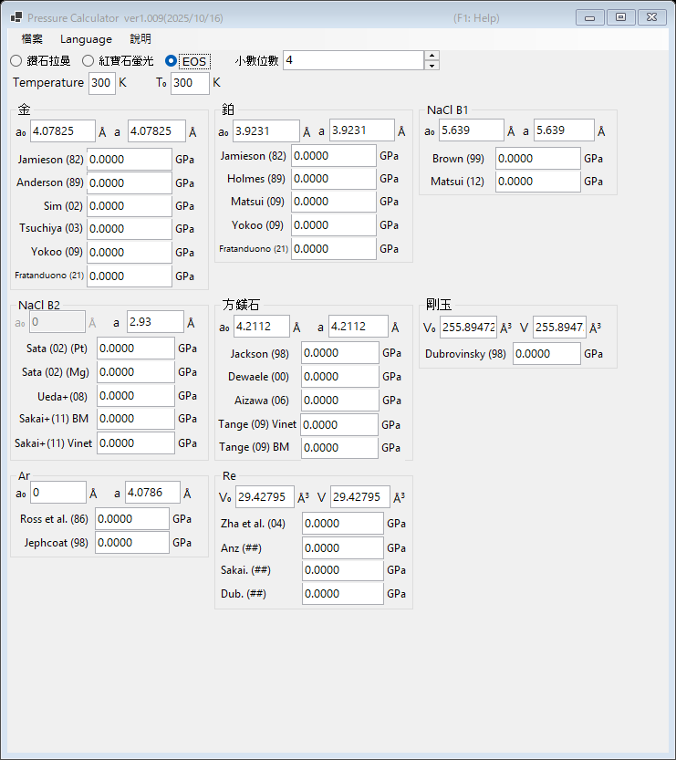

# 3. 狀態方程式 (EOS)

利用已發表的狀態方程式，由標準物質的晶格常數（或單位晶胞體積）測量值決定壓力。這是高壓 X 光繞射實驗中的標準方法。請在主視窗上方選擇 **EOS**。

{width=700px}

## 操作流程

1. 輸入測量溫度 **Temperature** 與參考溫度 **T₀**（單位 K）。熱狀態方程式會使用這兩個值；室溫標度則忽略其差異。
2. 對每種標準物質，輸入常壓下的晶格常數 **a₀** (Å) 與測得的晶格常數 **a** (Å)。剛玉與錸則改為輸入單位晶胞體積 **V₀** 與 **V** (ų)。
3. 各已發表標度計算出的壓力會立即顯示（單位 GPa）。

## 可用的標準物質與標度

| 物質 | 標度 |
|---|---|
| 金 | Jamieson (1982), Anderson (1989), Shim (2002), Tsuchiya (2003), Yokoo (2009), Fratanduono (2021) |
| 鉑 | Jamieson (1982), Holmes (1989), Matsui (2009), Yokoo (2009), Fratanduono (2021) |
| NaCl B1 | Brown (1999), Matsui (2012) |
| NaCl B2 | Sata (2002)（Pt/Mg 壓力參考）, Ueda+ (2008), Sakai+ (2011) BM/Vinet |
| 方鎂石 (MgO) | Jackson (1998), Dewaele (2000), Aizawa (2006), Tange (2009) Vinet/BM |
| 剛玉 (Al₂O₃) | Dubrovinsky (1998) |
| Ar | Ross et al. (1986), Jephcoat (1998) |
| Re | Zha et al. (2004) 等 |
| Mo | Zhao+ (2000), Huang+ (2016) MGD |
| Pb | Strässle+ (2014) |

!!! note
    同一物質的不同標度所得的壓力可能相差數個百分點，在數百 GPa（multimegabar）的超高壓下尤為明顯。發表結果時請註明所使用的標度。

## 適用溫度範圍

每個標度只在一定的溫度範圍內有效。當 **Temperature**（Pb 還包括 **T₀**）超出某標度的範圍時，該標度的壓力以紅色顯示，**T₀** 右側會出現「⚠ 紅色：…」提示，數值的工具提示會列出有效範圍。壓力本身仍照常（外推）計算，數值不作更改。

| 物質 | 標度 | 有效範圍 | 依據 |
|---|---|---|---|
| 金 | Jamieson (1982) | 200–1500 K | 已發表數據表的範圍（範圍外為外推） |
| 金 | Anderson (1989) | ≥ 300 K | 熱壓力與 (T − 300 K) 成線性；在室溫以下沒有物理意義 |
| 金 | Shim (2002) | — | Mie–Grüneisen–Debye 熱壓力；未設定範圍（不警告） |
| 金 | Tsuchiya (2003) | 300–2500 K | 已發表數據表的範圍（範圍外為外推） |
| 金 | Yokoo (2009) | 0–3000 K | 已發表數據表的範圍（範圍外為外推） |
| 金 | Fratanduono (2021) | 290–310 K | 室溫（300 K）等溫線；不使用溫度 |
| 鉑 | Jamieson (1982) | 200–1500 K | 已發表數據表的範圍（範圍外為外推） |
| 鉑 | Holmes (1989) | ≥ 300 K | 熱壓力與 (T − 300 K) 成線性；在室溫以下沒有物理意義 |
| 鉑 | Matsui (2009) | ≤ 3000 K | 作者給出的範圍（至 3000 K、300 GPa） |
| 鉑 | Yokoo (2009) | 0–3000 K | 已發表數據表的範圍（範圍外為外推） |
| 鉑 | Fratanduono (2021) | 290–310 K | 室溫（300 K）等溫線；不使用溫度 |
| NaCl B1 | Brown (1999) | 300–1200 K | 已發表數據表的範圍（範圍外為外推） |
| NaCl B1 | Matsui (2012) | — | Mie–Grüneisen–Debye 熱壓力；未設定範圍（不警告） |
| NaCl B2 | Sata (2002) (Pt), (Mg) | 290–310 K | 室溫（300 K）等溫線；不使用溫度 |
| NaCl B2 | Ueda+ (2008) | ≥ 300 K | 熱壓力與 (T − 300 K) 成線性；在室溫以下沒有物理意義 |
| NaCl B2 | Sakai+ (2011) BM, Vinet | 290–310 K | 室溫（300 K）等溫線；不使用溫度 |
| 方鎂石 (MgO) | Jackson (1998), Dewaele (2000), Aizawa (2006), Tange (2009) Vinet/BM | — | Mie–Grüneisen–Debye 熱壓力；未設定範圍（不警告） |
| 剛玉 (Al₂O₃) | Dubrovinsky (1998) | ≥ 300 K | 熱膨脹與 K(T) 的高溫擬合式；在室溫以下沒有物理意義 |
| Ar | Ross et al. (1986) | 290–310 K | 室溫（300 K）等溫線；不使用溫度 |
| Ar | Jephcoat (1998) | — | Mie–Grüneisen–Debye 熱壓力；未設定範圍（不警告） |
| Re | Zha et al. (2004) | 300–3000 K | 已發表數據表的範圍（範圍外為外推） |
| Re | Anz (##), Sakai. (##), Dub. (##) | 290–310 K | 室溫（300 K）等溫線；不使用溫度 |
| Mo | Zhao+ (2000) | ≥ 300 K | 熱膨脹與 K(T) 的高溫擬合式；在室溫以下沒有物理意義 |
| Mo | Huang+ (2016) MGD | — | Mie–Grüneisen–Debye 熱壓力；未設定範圍（不警告） |
| Pb | Strässle+ (2014) | T: 0–300 K, T₀: 0–310 K | 已發表數據表的範圍（範圍外為外推） |

對於 300 K 等溫線，為避免室溫輸入（如 295 K）觸發警告，在 290–310 K 之間不顯示警告。視窗中標為「Anz」「Sakai.」「Dub.」的 Re 標度也是 300 K 等溫線。
